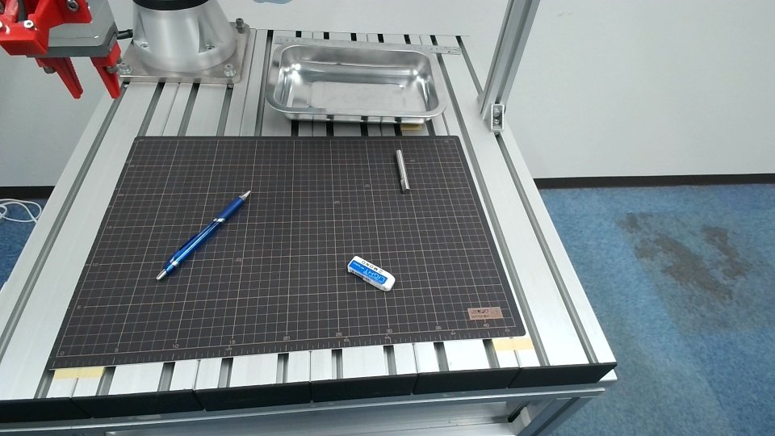
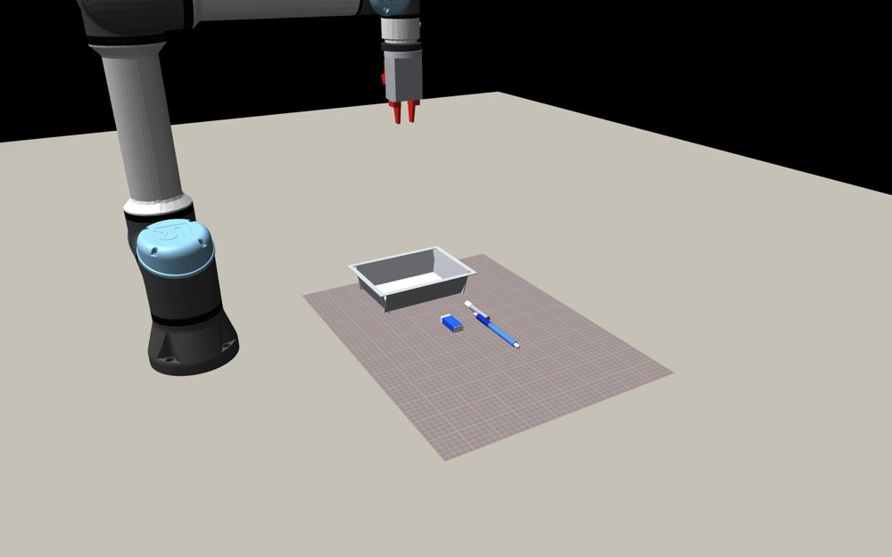

# UR5e × d1-3B ピッキング
### 判断は判断 AI、数値と安全はプログラム

> *ノート PC の GPU（8GB）で動く 30 億パラメータの判断 AI に、ロボットの判断を任せる。*

## デモ

[](https://youtu.be/lYeGFU9pLR8)

▶ **[YouTube で動画を見る](https://youtu.be/lYeGFU9pLR8)**

## 実機とシミュレーター

| 実機（三脚のカメラで見た机） | シミュレーター（MuJoCo） |
|---|---|
|  |  |

協働ロボット UR5e と 2 本指の電動ハンドで、机の上の物（消しゴム・ペン・銀の棒）を箱に入れるコードです。
判断は Liquid AI の判断専用モデル **d1-3B** に任せ、寸法・距離の計算と安全の処理はプログラムで行います。
d1-3B は、状態（文章や画像）と選択肢を渡すと、選択肢ごとの確率を 1 回の計算で返します。追加の学習も、物体検出のモデルも使っていません。

---

## ハードウェア

| 機器 | つなぎ方 | 通信・ライブラリ |
|---|---|---|
| Universal Robots UR5e | Ethernet | RTDE / ur_rtde |
| 電動 2 本指ハンド（TAIYO ESG1、開き最大 24.8mm） | USB シリアル | 自作基板（Arduino Nano ＋ TMC2209） |
| 三脚のカメラ（机全体を見る） | USB | OpenCV |
| 手首のカメラ | USB | OpenCV |
| ノート PC（RTX 5050 Laptop GPU 8GB、Windows 11） | — | PyTorch / transformers |

---

## 特長

- **役割を分ける** — 数値はプログラムが測って選択肢の説明文に書き、d1-3B は選ぶだけ。d1-3B は物を見分けるのは得意（97%）でも、距離の比較は苦手（57%）だったため
- **安全は選択肢の側で守る** — 届かない位置・手首が回りすぎる向き・指に入らない幅は、聞く前に外す。どれが選ばれても危ない動きにならない
- **力の監視が最優先** — 下りている間に手先の力が 20N 増えたら、AI の答えに関係なく上がる
- **止まらずに追ってつかむ** — 三脚のカメラが 0.1 秒ごとに物の位置を測り、腕は servoL で物の上へ寄せながら下りる
- **答えを待たない判断** — 0.2 秒ごとに裏で d1-3B に「寄せる／先回り／下りる」「今閉じる／もう少し追う」を聞き、腕は最新の答えに従う
- **判断 1 回 66ms** — FP8 化と CUDA グラフの使い回しで、画像つきの判断を 202ms から短縮（169 問で答えは元の実装とすべて同じ）
- **クラウドを使わない** — 判断はすべてノート PC の中で行う
- **実機と同じ命令で動くシミュレーター** — ur_rtde と同じ名前の命令（moveL など）で動き、ロボット・ハンド・カメラだけを差し替えて同じプログラムを流せる

---

## 構成

```
track_real.py（本線：見つける → 決める → 追う → つかむ → 箱へ）
    ├── 三脚のカメラ ─── OpenCV ────▶ 物の位置・向き・寸法を 0.1 秒ごとに測る（measure.py）
    ├── 手首のカメラ ─── OpenCV ────▶ つかむ直前の確認
    ├── d1_server.py ─── HTTP ──────▶ d1-3B（GPU、常駐）
    │     ├── 物の種類・運ぶ物・運ぶ順番（kind_ai.py / plan_ai.py）
    │     └── 0.2 秒ごと：寄せ方・閉じるか（裏の糸、腕は待たない）
    ├── UR5e ─────────── ur_rtde ───▶ servoL で追う・手先の力を監視（20N で上がる）
    └── hand_server.py ── USB シリアル ▶ 電動ハンド（常駐。動かす前に位置と状態を読む）

robot/sim_rtde.py ── ur_rtde と同じ命令名 ──▶ MuJoCo のシミュレーター（同じプログラムをそのまま流す）
```

---

## 使い方

```bash
# 1. 入れるもの（PyTorch は CUDA 版を入れる）
pip install -r requirements.txt

# 2. 判断 AI のサーバー（GPU）
python real_ur/d1_server.py

# 3. カメラ（三脚のカメラを 0.1 秒ごとに撮る）
CAM_TRI_EVERY=0.1 python real_ur/cam_view.py --cam 2 --cam2 1

# 4. 実機（--go が無ければ、見つけて決めるだけで腕は動かさない）
python real_ur/track_real.py --ip 192.0.2.10 --say 全部の物を箱に入れて --go

# シミュレーターで試す
python robot/test_track_real.py 5 --show --say=全部の物を箱に入れて
```

- `192.0.2.10` は例の番号です。使うロボットの IP アドレスに置き換えてください。
- d1-3B のモデルの重みは、Liquid AI の配布元（Hugging Face の `LiquidAI/d1-3B`）から取得してください。このリポジトリには入っていません。
- MuJoCo Menagerie の UR5e と Robotiq 2F-85 のモデルは `models/menagerie/` に置きます（`robot/*.xml` はそこを参照します）。
- 録画・ログ・カメラの画像は入っていません。

| 場所 | 中身 |
|---|---|
| `real_ur/` | 実機用。`track_real.py`（本線）、`pick_pass.py`（止まって撮ってからつかむ前の版）、`kind_ai.py`・`plan_ai.py`（d1-3B への問い方）、`measure.py`（画像処理で寸法を測る）、`hand.py`（ハンド）、`d1_server.py`（判断 AI のサーバー）、校正の道具と校正値 |
| `robot/` | MuJoCo のシミュレーター。`sim_rtde.py` は ur_rtde と同じ名前の命令で動く代わりのロボット。`test_*.py`・`eval_*.py` は試験と評価 |
| `d1_fast.py` ほか | d1-3B を速く動かす実装（FP8 化、CUDA グラフの使い回し） |
| `docs/` | 技術仕様書とシミュレーターの説明 |

---

## 実機で解決したこと

**1. 道具の長さが実物と違った**
ロボットに設定された道具の長さは 21.1cm だが、指先までの実物は約 15.5cm だった。ロボット側の設定は変えず、PC 側で差を直した。

**2. ハンドがリセットされて鳴った**
物を持ったままハンドの USB をつなぎ直すと、ハンドが原点合わせを始めた。ハンドを制御するプログラムを常に起動したままにし、動かす前に必ず位置と状態を読むようにした。

**3. 下りすぎてペンにひびを入れた**
時間切れの後もそのまま下りて、指でペンを押し付けた。下りている間に手先の力が 20N 増えたら、上がるようにした。

**4. 何も触れていないのに力を検出して止まった**
速度の指令をいきなり出し、いきなり止めていたため、急な加減速が力の推定値に出ていた。加速と減速を入れた。

**5. 消しゴムを「なでて終わる」**
三脚のカメラで測った幅が大きめに出て、指を開いた時点で「触れた」と判定していた。「閉じ始めから 2mm 以上閉じた」を条件に足し、その後は 5 回とも成功した。

**6. つかむ位置が数 mm ずれる**
物を置き直す時に三脚に手が触れていた。動く前に校正時の画像と比べ、3 画素より動いていたら止まるようにした。

**7. 選択肢の文面で正解率が変わる**
「ペン以外を箱に入れて」などの 14 の指示文で、物ごとに「はい・いいえ」で聞くと 8 つしか正しくなかった。物の種類ごとに「入れる／残す」を選ばせると、14 すべてで正しくなった（シミュレーター）。文面は、記録した状態をモデルに直接聞いて、実機の前に評価する。

まだ解決していないこと：ペンの中央の透明で銀色の部分で輪郭が切れ、ペンが 2 つの物に見えることがある。

---

## 結果

- 「全部の物を箱に入れて」で 3 つとも箱に入れる一連の作業に、4 回成功
- 1 つの物を箱に入れるまで約 15 秒（速くするのが次の課題）
- 試行は少なく、物は 3 種類、机は 1 つだけ。成功率を統計的に言える段階ではない

---

## 使ったもの

- **Claude Code** — 開発の相棒
- Python / PyTorch / transformers / torchao
- ur_rtde、OpenCV、MuJoCo（MuJoCo Menagerie のモデル）
- [LiquidAI/d1-3B](https://huggingface.co/LiquidAI/d1-3B)（LFM Open License v1.0）

---

## ライセンス

このリポジトリのコードは MIT License です（`LICENSE`）。d1-3B のモデルは含まず、LFM Open License v1.0 に従います。

## 付記

株式会社スリーアップ・テクノロジー様でのインターンシップにおける実習として取り組んだ内容です。
解説記事：note（公開後にリンクを追加します）
